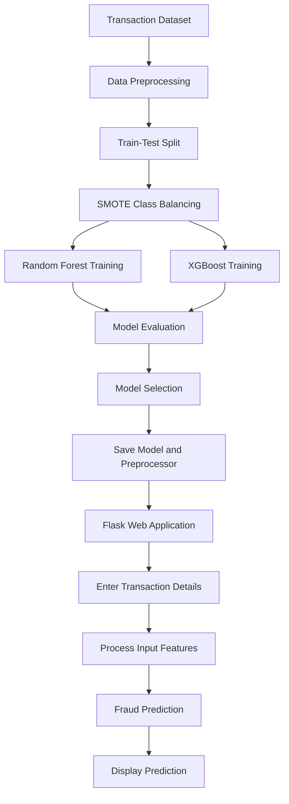

 # Credit Card Fraud Detection Using Machine Learning

## Project Overview

Credit Card Fraud Detection is a machine learning project designed to identify potentially fraudulent credit card transactions based on transaction-related features. The system uses Random Forest and XGBoost classification algorithms to distinguish between legitimate and fraudulent transactions.

The project addresses class imbalance using the Synthetic Minority Over-sampling Technique (SMOTE), evaluates model performance using standard classification metrics, and integrates the trained model into a Flask-based web application for transaction prediction.

## Objectives

- Detect potentially fraudulent credit card transactions using machine learning.
- Handle imbalanced transaction data using SMOTE.
- Train and compare Random Forest and XGBoost classifiers.
- Evaluate model performance using accuracy, precision, recall, F1-score, and a confusion matrix.
- Save trained models and preprocessing components for future use.
- Integrate the selected model with a Flask web application for transaction prediction.

## Key Features

- Machine learning-based transaction classification.
- Class imbalance handling using SMOTE.
- Training and comparison of Random Forest and XGBoost models.
- Model evaluation using standard classification metrics.
- Model persistence using Joblib and XGBoost JSON serialization.
- Flask-based web interface for transaction prediction.
- Separate prediction logic for improved code organization.

## Technologies Used

| Category | Technologies |
|---|---|
| Programming Language | Python |
| Machine Learning | Scikit-learn, XGBoost |
| Data Processing | Pandas, NumPy |
| Class Imbalance Handling | imbalanced-learn, SMOTE |
| Web Framework | Flask |
| Frontend | HTML, CSS |
| Model Serialization | Joblib, XGBoost JSON |
| Development Environment | Google Colab, Visual Studio Code |
| Version Control | Git, GitHub |

## Project Workflow

The project follows these steps:

1. **Data Preparation:** Load and inspect the transaction dataset.
2. **Data Preprocessing:** Clean the data and transform numerical and categorical features.
3. **Train-Test Split:** Divide the dataset into training and testing sets.
4. **Class Imbalance Handling:** Apply SMOTE to the training data to improve minority-class representation.
5. **Model Training:** Train Random Forest and XGBoost classifiers.
6. **Model Evaluation:** Compare the models using accuracy, precision, recall, F1-score, and a confusion matrix.
7. **Model Selection:** Select a suitable classifier based on evaluation results.
8. **Model Export:** Save the trained model and preprocessing components.
9. **Web Integration:** Connect the selected model to the Flask application.
10. **Prediction:** Accept transaction details and display the predicted transaction class.

### Workflow Diagram



**Note:** SMOTE is applied only to the training data. The test data retains its original class distribution to support a meaningful evaluation.

## Project Structure

```text
EDP_WEEK_10/
|
|-- models/
|   |-- preprocessor.pkl
|   |-- xgb_classifier.json
|   |-- fraud_detection_model.pkl
|   |-- fraud_detection_model_backup.pkl
|
|-- notebooks/
|   |-- EDPProjectNEW12Oct.ipynb
|
|-- src/
|   |-- predict.py
|
|-- templates/
|   |-- index.html
|
|-- app.py
|-- requirements.txt
|-- .gitignore
|-- README.md
```

### Directory Description

- `models/`: Stores trained models and preprocessing artifacts.
- `notebooks/`: Contains the Jupyter notebook used for model development and evaluation.
- `src/predict.py`: Contains the prediction logic.
- `templates/index.html`: Defines the frontend interface.
- `app.py`: Runs the Flask application and handles prediction requests.
- `requirements.txt`: Lists the Python dependencies.
- `.gitignore`: Specifies files and directories excluded from version control.
- `README.md`: Provides project documentation and setup instructions.

The filenames shown above should match the actual files in the repository.

## Installation and Setup

### Prerequisites

Install the following software before running the project:

- Python 3.10 or a compatible version supported by the project dependencies
- Git
- pip

### Step 1: Clone the Repository

```bash
git clone https://github.com/yuvasai6456/EDP_WEEK_10.git
cd EDP_WEEK_10
```

### Step 2: Create a Virtual Environment

```bash
python -m venv .venv
```

### Step 3: Activate the Virtual Environment

For Windows Command Prompt:

```cmd
.venv\Scripts\activate
```

For Windows PowerShell:

```powershell
.\.venv\Scripts\Activate.ps1
```

For Linux or macOS:

```bash
source .venv/bin/activate
```

### Step 4: Install Dependencies

```bash
python -m pip install --upgrade pip
pip install -r requirements.txt
```

Ensure that `requirements.txt` includes all required packages, such as Flask, Pandas, NumPy, Scikit-learn, XGBoost, imbalanced-learn, and Joblib, as applicable to the implementation.

## Running the Application

After installing the dependencies, start the Flask application:

```bash
python app.py
```

Open the following URL in your browser:

```text
http://127.0.0.1:5000
```

Enter the required transaction details in the web interface and submit them to obtain a prediction.

Ensure that the saved model and preprocessing files are available at the paths expected by the application.

## Model Evaluation

The models are evaluated using the following metrics:

| Metric | Description |
|---|---|
| Accuracy | Measures the proportion of correctly classified transactions. |
| Precision | Measures the proportion of predicted fraudulent transactions that are actually fraudulent. |
| Recall | Measures the proportion of actual fraudulent transactions correctly identified. |
| F1-Score | Represents the harmonic mean of precision and recall. |
| Confusion Matrix | Summarizes correct and incorrect predictions for each class. |

### Importance of Evaluation Metrics

Credit card fraud datasets are often highly imbalanced, with legitimate transactions significantly outnumbering fraudulent transactions. Consequently, accuracy alone may not accurately represent a model's effectiveness.

Precision helps assess false fraud alerts, while recall measures the model's ability to identify fraudulent transactions. The F1-score provides a balance between these two metrics.

The final model should be selected based on the actual evaluation results and the project's fraud detection requirements.

Actual metric values should be added after evaluating the trained models. No performance scores are assumed in this documentation.

## How the System Works

1. The user provides transaction-related details through the web interface.
2. The application preprocesses the input using the saved preprocessing component.
3. The processed features are passed to the trained classification model.
4. The model predicts the transaction class.
5. The Flask application displays the prediction to the user.

The prediction indicates whether a transaction is potentially fraudulent or legitimate according to the trained model. It does not guarantee that a transaction is genuinely fraudulent or legitimate.

## Future Enhancements

- Develop an interactive dashboard for transaction monitoring.
- Display model evaluation results through visualizations.
- Improve model selection using cross-validation and precision-recall analysis.
- Introduce configurable fraud detection thresholds.
- Deploy the application to a cloud platform.
- Improve input validation, logging, and error handling.
- Evaluate the system on additional unseen transaction datasets.

## Disclaimer

This project is developed for educational and academic purposes. Its predictions depend on the dataset, selected features, preprocessing techniques, and trained model. It is not intended to replace a production-grade fraud detection system or professional financial risk assessment.

## Author

**G. Yuva Sai**

Project: Credit Card Fraud Detection Using Machine Learning

GitHub Repository: https://github.com/yuvasai6456/EDP_WEEK_10
